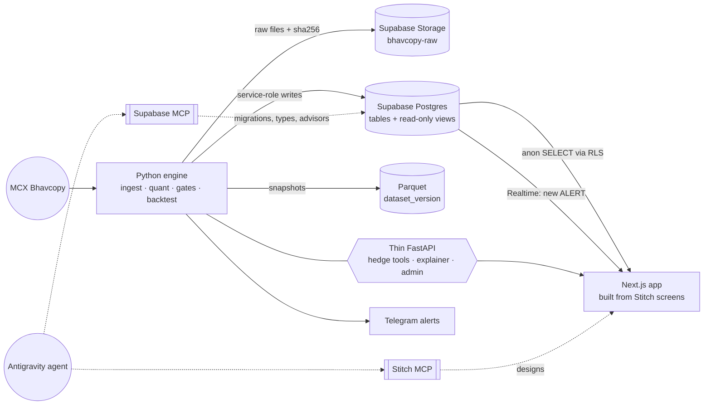

# AurumLens — Phase-wise Build Plan for Google Antigravity
### with Stitch MCP (UI design) and Supabase MCP (database)

> **Version:** 1.0 · **Date:** 2026-10-01
> **Companion to:** PRD v2, Design v2, Phase v2, phase_wiseprompt v2.
>
> **Stack decision v2.1:** this plan replaces the storage and UI choices in Design v2 §2. Everything else in the v2 docs still applies: the analytical rules (R1–R25), features (FR1–FR32), gates, tests and exit gates. See `CHANGELOG.md` v2.1.

---

## 0. What changes, and why

| Concern | v2 docs | This plan | Why |
|---|---|---|---|
| System of record | DuckDB | **Supabase Postgres** | Hosted database, auth, realtime and storage, all manageable by the agent through MCP |
| Raw file store | `data/raw/` folder | **Supabase Storage** bucket `bhavcopy-raw` (private) plus a local cache | Immutable evidence with a sha256 per file |
| Reproducible snapshots | Parquet | **Parquet (kept)** | Dataset versioning and the offline demo |
| Quant engine | Python pure functions | **Python pure functions (unchanged)** | All formulas stay in one tested place |
| API | FastAPI | **Supabase auto-API (reads)** + **thin FastAPI** (hedge tools, explainer, admin) | Reads come straight from read-only views; computation never moves into SQL or the UI |
| UI | Streamlit | **Stitch-designed screens → Next.js (React, TypeScript, Tailwind)** | Judge-grade UI; Stitch produces screen HTML the agent converts into components |
| Alerts | Telegram | Telegram + **Supabase Realtime** (live ALERT feed in the UI) | |

**Rules that do not change:**
- No formulas in the UI or in SQL views; the views only select and join.
- The Python engine is the only writer to the database.
- No live broker calls.

---

## 1. Target architecture



**Security boundary:**
- The browser only ever holds the Supabase **publishable (anon) key** and can only `SELECT` from public views.
- The **service-role key** lives only in the Python engine's environment.
- Admin actions go through FastAPI behind an admin token or a Supabase Auth admin session.

---

## 2. Phase map

| Phase | Name | Main tools | Exit gate |
|---|---|---|---|
| **A0** | Workspace & MCP setup | Antigravity, Stitch MCP, Supabase MCP | Agent can list Stitch projects and Supabase tables |
| **A1** | Source verification & skeleton | Antigravity agent, browser | 1 real Bhavcopy day per format era, parsed and checked by hand |
| **A2** | Supabase schema, RLS & storage | Supabase MCP (**write mode, temporarily**) | Migrations applied; security advisors clean; TypeScript types generated |
| **A3** | Historical data engine → Supabase | Python, Supabase MCP (read-only) | Several years loaded; validation report; zero silent duplicates |
| **A4** | Quant core | Python, pytest | Hand-calculated fixtures match exactly (120,482.41 · Nov-5 pairing · 0.00014597 spread · 4:5 lots) |
| **A5** | Signal engine | Python, Supabase MCP (read-only) | Real ALERT, QUIET-with-nearest-miss and blocked-trap examples |
| **A6** | Walk-forward backtest | Python, Supabase | No-leakage tests pass; reproducible; baselines + Deflated Sharpe |
| **A7** | UI design in Stitch | **Stitch MCP** | 9 approved screens + design tokens |
| **A8** | Frontend build | Antigravity + Stitch MCP + Supabase MCP | All screens live on real data; offline mode works |
| **A9** | Explain, alerts, paper trading | Python, FastAPI, Realtime, Telegram | Replayed alert: signal → explanation → paper trade → exit → evidence pack |
| **A10** | Hardening & demo | All | 3 consecutive clean offline rehearsals |

**Parallel tracks:**
- **A7 (Stitch design)** can start as soon as A2 is done, alongside A3–A6.
- **A8** starts once A5 produces real evidence rows.

```text
A0 → A1 → A2 → A3 → A4 → A5 → A6 ──────────┐
                └→ A7 (Stitch) ──→ A8 (UI) ─┴→ A9 → A10
```

---

## 3. Phase A0 — Workspace & MCP setup

### 3.1 Accounts and keys (you do these steps yourself)
1. **Supabase:** create a **dev** project (for example `aurumlens-dev`). Note its **project ref** (Project Settings → General). Never point the agent at a production project.
2. **Stitch:** go to stitch.withgoogle.com → Settings → API Keys → **Create API Key**.
3. **Telegram** (needed later, in A9): create a bot with @BotFather and keep the token for `.env`.
4. **Local tools:** Node 20+, Python 3.12, Docker Desktop (for local Supabase / offline demo), and the Supabase CLI.

### 3.2 Repo skeleton
```text
aurumlens/
├── AGENTS.md                  # agent rules (copy of .cursorrules v2.1); also add as an Antigravity rule
├── docs/                      # PRD, Design, Phase, System_architecture, CHANGELOG, this plan
├── engine/                    # Python package (src/aurumlens/... from Design v2 §3)
│   ├── src/aurumlens/
│   ├── tests/
│   └── pyproject.toml
├── api/                       # thin FastAPI (tools, explainer, admin)
├── web/                       # Next.js app built from Stitch screens
├── supabase/                  # supabase init → migrations/, seed.sql, config.toml
├── config/                    # contracts.yaml, costs.yaml, strategy.yaml, events.yaml
├── data/{cache,processed,fixtures}/   # git-ignored except fixtures
├── .env.example               # names only, no values
└── .gitignore                 # .env*, data/cache, data/processed, .agents/mcp_config.json
```

### 3.3 MCP configuration
In the Antigravity IDE: agent side panel → `…` → **MCP Servers** → **Manage MCP Servers** → **View raw config**.

Use the **global** config (`~/.gemini/config/mcp_config.json`) so keys never land in the repo. If you use the workspace file `.agents/mcp_config.json` instead, keep it in `.gitignore`.

```json
{
  "mcpServers": {
    "stitch": {
      "serverUrl": "https://stitch.googleapis.com/mcp",
      "headers": { "X-Goog-Api-Key": "<YOUR_STITCH_API_KEY>" }
    },
    "supabase": {
      "serverUrl": "https://mcp.supabase.com/mcp?project_ref=<YOUR_DEV_PROJECT_REF>&read_only=true&features=database,docs,development,debugging",
      "headers": { "Authorization": "Bearer <YOUR_SUPABASE_PERSONAL_ACCESS_TOKEN>" }
    },
    "supabase-write": {
      "serverUrl": "https://mcp.supabase.com/mcp?project_ref=<YOUR_DEV_PROJECT_REF>&features=database,development,debugging",
      "headers": { "Authorization": "Bearer <YOUR_SUPABASE_PERSONAL_ACCESS_TOKEN>" },
      "disabled": true
    }
  }
}
```

**Notes:**
- **Easier Supabase option:** add Supabase from Antigravity's **MCP Store**. It connects to the hosted server and signs in through the browser (OAuth), so no access token is needed. Then edit the URL to add `project_ref`, `read_only=true` and `features`.
- **Read-only by default.** The `supabase` server runs every query as a read-only Postgres user. Enable `supabase-write` **only during A2 and later schema migrations**, then disable it again.
- **Project scoping:** `project_ref` limits the server to one project and turns off account-level tools.
- **Offline demo:** the local Supabase stack also exposes MCP at `http://localhost:54321/mcp`. Add it as a third entry if you want the agent to work against local data.
- **Stitch tools exposed:** `create_project`, `list_projects`, `get_project`, `list_screens`, `get_screen`, `generate_screen_from_text`.
- **Supabase tools you'll use most:** `list_tables`, `execute_sql`, `apply_migration` (write mode only), `generate_typescript_types`, `get_project_url`, `get_publishable_keys`, plus the debugging group (logs and advisors).

### 3.4 Agent rules
Copy `.cursorrules` v2.1 into `AGENTS.md` at the repo root. Also add it as a workspace rule in Antigravity's customizations, so every agent session follows the quant rules.

### 3.5 Exit gate: test prompts in the agent panel
- *"Using the Stitch MCP, list my Stitch projects."* This should return a list, even an empty one.
- *"Using the supabase MCP, list tables in the public schema."* This should return an empty list without error.
- *"Try to create a table using the supabase MCP."* This must be **refused** because the server is read-only. That proves the safety setting works.

---

## 4. Phase A1 — Source verification & skeleton
Same scope as **Phase 0 in Phase.md v2**:
- the facts register F1–F16;
- GUINEA purity;
- circular MCX/TRD/456/2025;
- sample Bhavcopy files from **both** format eras;
- the settlement field;
- GOLDTEN's first date;
- the cost schedule.

Antigravity's built-in browser is useful for reading MCX and SEBI documents. Save every source link into `config/contracts.yaml`.

**Agent prompt (Planning mode):**
> Read AGENTS.md and docs/*. Implement Phase A1 only (= Phase 0 in docs/Phase.md).
> - Create the repo skeleton from section 3.2, the Pydantic config models, `.env.example`, pytest and the CI workflow.
> - Use the browser to locate official MCX contract specifications for GOLDM, GOLDTEN, GOLDGUINEA and GOLDPETAL. Fill `config/contracts.yaml` with value, status, source URL and verified_at per field. Never guess; unknowns stay null with status TO_VERIFY. GOLDGUINEA purity stays DISPUTED until an official document resolves it.
> - Download one Bhavcopy file from before Oct 2023 and one from after (CDP format) into `data/fixtures/real_samples/`, and write the two adapters' column mappings.
> - Stop and report against the exit gate.

**Exit gate:** you have personally compared one parsed day per era against the raw file.

---

## 5. Phase A2 — Supabase schema, RLS & storage
**Enable `supabase-write` for this phase only.**

**Agent prompt:**
> Using the supabase-write MCP, create migrations (`apply_migration`, one per logical step, also saved under `supabase/migrations/`) for the schema below.
> - Enable RLS on every table.
> - Anon and authenticated roles may only SELECT from analytics tables. No insert, update or delete policies, so only the service role (the Python engine) can write.
> - Create the private Storage bucket `bhavcopy-raw`.
> - Then run the security and performance advisors, fix any warnings, and generate TypeScript types into `web/lib/database.types.ts`.
> - Report the list of tables and policies.

### 5.1 Initial migration (starting point; the agent may refine it, but must keep keys and constraints)
```sql
-- 001_core.sql
create table public.contract_spec (
  symbol text primary key check (symbol in ('GOLDM','GOLDTEN','GOLDGUINEA','GOLDPETAL')),
  trading_unit_g numeric, quote_basis_g numeric, purity numeric,
  expiry_rule text, tender_days int, tick_size numeric,
  field_status jsonb not null default '{}'::jsonb,   -- {"purity":"DISPUTED", ...}
  source_reference text, verified_at timestamptz
);

create table public.source_file (
  file_id bigint generated always as identity primary key,
  requested_date date not null,
  returned_date date,
  adapter text not null check (adapter in ('legacy','cdp')),
  sha256 text not null unique,
  storage_path text not null,
  status text not null check (status in ('OK','REJECTED')),
  reject_reason text,
  fetched_at timestamptz not null default now()
);

create table public.contract (
  contract_id text primary key,                       -- e.g. GOLDM_20261105
  symbol text not null references public.contract_spec(symbol),
  expiry_date date not null,
  first_seen date, last_seen date,
  unique (symbol, expiry_date)
);

create table public.daily_price (
  contract_id text not null references public.contract(contract_id),
  trade_date date not null,
  open numeric, high numeric, low numeric, close numeric, settlement numeric,
  volume bigint, open_interest bigint,
  price_used numeric,
  price_source text check (price_source in ('settlement','close')),
  price_quality text not null check (price_quality in ('OK','SUSPECT')),
  quality_reason text,
  normalized_price numeric,
  file_id bigint not null references public.source_file(file_id),
  dataset_version text not null,
  primary key (contract_id, trade_date)
);

-- 002_analytics.sql
create table public.pair_daily (
  pair_id text not null, trade_date date not null, config_version text not null,
  leg_a_contract_id text not null references public.contract(contract_id),
  leg_b_contract_id text not null references public.contract(contract_id),
  expiry_gap_days int, norm_a numeric, norm_b numeric,
  log_spread_raw numeric, carry_rate numeric,
  carry_source text check (carry_source in ('CURVE','FALLBACK')),
  carry_adj numeric, log_spread_adj numeric, roll_mean numeric, roll_std numeric, zscore numeric,
  rich_leg text, lots_a int, lots_b int, residual_fine_g numeric,
  expected_convergence_inr numeric, cost_total_inr numeric, slippage_inr numeric, buffer_inr numeric,
  net_edge_inr numeric, dataset_version text not null,
  primary key (pair_id, trade_date, config_version)
);

create table public.gate_result (
  pair_id text not null, trade_date date not null, config_version text not null,
  gate_no smallint not null check (gate_no between 1 and 11),
  gate text not null, passed boolean not null,
  value numeric, threshold numeric, margin numeric, reason_code text,
  primary key (pair_id, trade_date, config_version, gate_no)
);

create table public.signal (
  signal_id uuid primary key default gen_random_uuid(),
  pair_id text not null, trade_date date not null, config_version text not null,
  status text not null check (status in ('QUIET','ALERT')),
  direction text, reason_codes text[] not null default '{}',
  near_miss_score numeric,
  evidence jsonb not null,                       -- the full evidence record (PRD §11)
  dataset_version text not null,
  created_at timestamptz not null default now(),
  unique (pair_id, trade_date, config_version)
);

create table public.cost_line (
  id bigint generated always as identity primary key,
  signal_id uuid references public.signal(signal_id),
  trade_id uuid,
  leg text, side text check (side in ('BUY','SELL')),
  component text not null, amount_inr numeric not null
);

create table public.market_event (
  id bigint generated always as identity primary key,
  event_date date not null, label text not null, category text,
  source text, verified boolean not null default false
);

-- 003_backtest_paper.sql
create table public.backtest_run (
  run_id uuid primary key default gen_random_uuid(),
  dataset_version text not null, config_version text not null,
  folds jsonb not null, is_holdout boolean not null default false,
  summary jsonb, created_at timestamptz not null default now()
);
create table public.trial (
  trial_id uuid primary key default gen_random_uuid(),
  run_id uuid not null references public.backtest_run(run_id),
  params jsonb not null, train_metric numeric
);
create table public.trade (
  trade_id uuid primary key default gen_random_uuid(),
  run_id uuid references public.backtest_run(run_id),
  pair_id text not null, entry_date date not null, exit_date date,
  legs jsonb not null,                           -- actual contracts, lots, entry/exit prices
  gross_pnl numeric, costs numeric, slippage numeric, net_pnl numeric,
  strategy_pnl numeric, residual_gold_pnl numeric, exit_reason text
);
create table public.paper_position (
  position_id uuid primary key default gen_random_uuid(),
  signal_id uuid not null unique references public.signal(signal_id),  -- duplicate-execution guard
  state text not null check (state in ('OPEN','CLOSED','FAILED','PARTIAL')),
  legs jsonb not null, pnl jsonb, opened_at timestamptz default now(), closed_at timestamptz
);
create table public.audit_log (
  id bigint generated always as identity primary key,
  at timestamptz not null default now(), actor text not null, action text not null, detail jsonb
);

-- 004_rls_and_views.sql
do $$
declare t text;
begin
  foreach t in array array['contract_spec','source_file','contract','daily_price','pair_daily','gate_result',
                           'signal','cost_line','market_event','backtest_run','trial','trade','paper_position','audit_log']
  loop
    execute format('alter table public.%I enable row level security', t);
  end loop;
  foreach t in array array['contract_spec','contract','daily_price','pair_daily','gate_result',
                           'signal','cost_line','market_event','backtest_run','trial','trade']
  loop
    execute format('create policy "public read" on public.%I for select to anon, authenticated using (true)', t);
  end loop;
end $$;
-- source_file, paper_position, audit_log: readable by signed-in admins only
create policy "admin read" on public.source_file    for select to authenticated using (true);
create policy "admin read" on public.paper_position for select to authenticated using (true);
create policy "admin read" on public.audit_log      for select to authenticated using (true);

create view public.v_latest_status with (security_invoker = true) as
select distinct on (pair_id) pair_id, trade_date, status, reason_codes, near_miss_score, config_version
from public.signal order by pair_id, trade_date desc, created_at desc;

alter publication supabase_realtime add table public.signal;   -- live ALERT feed
```

### 5.2 Storage
- Private bucket `bhavcopy-raw`, with path `{era}/{yyyy}/{yyyy-mm-dd}_{sha256[:12]}.csv`.
- No public policies. Only the service role uploads, and files are never overwritten (the path includes the hash).

**Exit gate:**
- Migrations applied, and saved in `supabase/migrations/`.
- Advisors report no RLS or security warnings.
- `database.types.ts` generated.
- **`supabase-write` disabled again.**

---

## 6. Phase A3 — Historical data engine → Supabase
Same scope as **Phase 1 in Phase.md v2**, with Supabase as the target.

**Agent prompt:**
> Implement Phase A3 (= Phase 1 in docs/Phase.md) in `engine/`.
> - The downloader keeps a local cache in `data/cache/`, uploads each raw file to the `bhavcopy-raw` bucket with its sha256, and inserts a `source_file` row.
> - Adapters (legacy, cdp) map to the canonical schema. The validator rejects date mismatches and bad schemas. The quality stage sets price_used, price_source and the SUSPECT flags.
> - Upsert `contract` and `daily_price` through a repository layer that uses the service-role key from the environment (never committed).
> - Write Parquet snapshots with `dataset_version`.
> - Use the read-only supabase MCP to verify row counts and duplicates with SQL, and include those queries in the report.

**Exit gate:**
- Several years loaded.
- Validation report covering rows per symbol and era, rejects, SUSPECT counts, and GOLDTEN's first date.
- `select contract_id, trade_date, count(*) ... having count(*) > 1` returns zero rows.

---

## 7. Phases A4–A6 — Quant core, signal engine, backtest
These run exactly as **Phases 2, 3 and 4 in phase_wiseprompt.md v2**, with two changes:
- **Writes** go to `pair_daily`, `gate_result`, `signal` (with the full evidence JSON), `cost_line`, `backtest_run`, `trial` and `trade`.
- **Verification:** after each phase, ask the agent to use the read-only supabase MCP to spot-check three rows against the Python output. That proves the database matches the engine.

| Phase | Use this prompt | Must-pass checks |
|---|---|---|
| A4 | phase_wiseprompt "PHASE 2" | Purity direction test; fixtures 120,482.41 / Nov-5 / 0.00014597 / 4:5 |
| A5 | phase_wiseprompt "PHASE 3" | All 11 gates stored per pair-day; a constant offset never alerts; strict spec mode; no look-ahead |
| A6 | phase_wiseprompt "PHASE 4" | Fold isolation; trial registry; baselines; Deflated Sharpe responds to the number of trials; holdout run once |

---

## 8. Phase A7 — UI design in Stitch (parallel track)
**Goal:** nine on-brand screens approved before any frontend code.

### 8.1 Design-system prompt (first message to Stitch through the MCP)
> Create a Stitch project "AurumLens". Design system:
> - **Style:** a calm, professional fintech dashboard for Indian MCX gold markets.
> - **Colours:** ink #1E1E1E, slate #4B5563, deep gold #B7862C (accent), gold tint #FBF3E0, panel #F7F5F0, QUIET green #2E7D32, ALERT red #C62828.
> - **Type:** Inter or a similar clean sans-serif; numbers in tabular figures; rupee amounts in Indian grouping (₹1,20,482).
> - **Layout:** desktop-first at 1440 px, with a responsive mobile variant. Left navigation with 9 items.
> - **Footer:** a persistent "Analytics only — not investment advice".
> - **Status:** QUIET and ALERT must be readable by a non-trader within 3 seconds.

### 8.2 Screen prompts (one `generate_screen_from_text` call each)
| # | Screen | Prompt essentials |
|---|---|---|
| 1 | Overview | Large market status badge (QUIET/ALERT), 6 pair cards (status, z-score, net edge vs hurdle), a "nearest miss" card, data-freshness chip, config/dataset version, a "research mode — unverified specs" banner variant |
| 2 | Pair Analysis | Header with both contracts and expiries; normalized price chart; adjusted log spread; z-score chart with entry/exit bands; **11-row gate waterfall** with PASS/FAIL pills and margins; cost breakdown table; event markers; replay date picker |
| 3 | Backtest & Attribution | Fold table, separate holdout card, equity curve vs two baselines, bars from gross → costs → slippage → net, strategy vs residual gold, Deflated Sharpe tile, trade ledger table |
| 4 | Contract Calendar | Timeline per contract with expiries, red unsafe tender windows, liquid windows and event pins |
| 5 | Alert Log / Evidence | Filterable alert list; detail drawer with explanation (EN/हिंदी toggle), gate summary and "Export evidence (CSV/HTML)" |
| 6 | Hedge Tools | Three tabs: converter (one input → four equivalents), cheapest-to-hedge (grams input → ranked table with lots, residual grams, cost per 10 g, liquidity flag), lot-ratio sizer |
| 7 | Data Health & Spec Trust | Ingestion log, rejected dates, SUSPECT price list, facts register with status badges (VERIFIED_OFFICIAL / SECONDARY / DISPUTED / TO_VERIFY) |
| 8 | Methodology | Pipeline diagram, formulas in readable form, limitations, disclaimer |
| 9 | Paper Trading | Open and closed paper positions, P&L, audit trail; clearly labelled "Simulated — no real orders" |

**Agent prompt:**
> Using the Stitch MCP, create project "AurumLens" with the design system in section 8.1. Then generate the nine screens in section 8.2, one call each, using realistic but clearly labelled sample data. After each screen, fetch it with `get_screen` and save the HTML and screenshot to `web/design/stitch/<nn>-<name>/`. List anything that conflicts with the PRD (for example a formula shown in the UI, or a missing disclaimer).

**Exit gate:**
- You approve all 9 screens. Iterate in Stitch until you do.
- Design tokens are extracted to `web/design/tokens.json`.

---

## 9. Phase A8 — Frontend build (Next.js from Stitch)
**Agent prompt:**
> Build `web/` as a Next.js (App Router, TypeScript, Tailwind) app from the approved Stitch screens in `web/design/stitch/`. Use the Stitch MCP (`get_screen`) whenever you need the latest design.
> - **Data:** use `@supabase/supabase-js` with the **publishable key only** (fetch it with the supabase MCP's `get_publishable_keys`) and the generated `database.types.ts`.
> - **Reads:** read only from tables and views allowed by RLS.
> - **Hedge tools and explanations:** call the FastAPI service. **No formulas in the UI.**
> - **Live feed:** subscribe to Supabase Realtime on `signal` for live ALERT toasts.
> - **Replay:** a date picker that queries `signal`, `gate_result` and `pair_daily` for that date.
> - **States:** add loading, empty, stale-data and error states to every screen.
> - **Offline:** support `NEXT_PUBLIC_SUPABASE_URL` pointing to a local Supabase instance.
> - **Checks:** use the built-in browser to screenshot each screen against its Stitch design and fix differences.

**Exit gate:**
- All 9 screens run on real data.
- A non-trader understands status and one signal in about 30 seconds.
- Lighthouse accessibility score ≥ 90 on Overview and Pair Analysis.

---

## 10. Phase A9 — Explanations, alerts & paper trading
Runs as **PHASE 6 in phase_wiseprompt.md v2**, plus:
- **FastAPI routes:**
  - `/v1/tools/convert`, `/v1/tools/hedge-cost`, `/v1/tools/lot-ratio` (all reuse the engine's functions);
  - `/v1/signals/{id}/explain?lang=en|hi`;
  - `/v1/signals/{id}/evidence.(csv|html)`;
  - `/v1/admin/*`, protected by the admin token.
- **Telegram:** after the engine writes an `ALERT` row, it sends the message through the Telegram adapter, with dedupe by `signal_id`.
- **Paper trading:** a `paper_position` row with **unique `signal_id`** (duplicate-execution guard at the database level), plus an `audit_log` entry for every action.

**Exit gate:**
- A replayed historical alert flows end to end: signal → explanation (EN/HI) → paper position → exit → stored P&L → evidence pack.
- The new ALERT also shows up live in the UI.

---

## 11. Phase A10 — Hardening & demo

### 11.1 Offline demo (required by the PRD)
1. `supabase start` (Docker) runs a local stack.
2. `supabase db reset` applies `supabase/migrations/` plus a seed restored from the Parquet snapshot of the demo dataset.
3. Run FastAPI locally, then `next build && next start` with local URLs.
4. Optional: point a third MCP entry at `http://localhost:54321/mcp` for agent work during the event.

### 11.2 Checklist
- Phase 7 tasks in Phase.md v2:
  - the FR1–FR27 checklist;
  - performance;
  - secrets scan;
  - lineage spot-check;
  - three real demo dates.
- **Supabase advisors clean.** RLS checked with the anon key: writes must fail, reads must only return allowed tables.
- **Keys:** confirm no service-role key exists in `web/`, the git history or the build output.
- **Rehearsals:** three consecutive offline rehearsals, plus a backup video.

---

## 12. Working rhythm in Antigravity (every phase)
1. **New agent conversation per phase.** Paste the phase prompt and ask for the **implementation plan first** (Planning mode). Review the plan before letting it execute.
2. **Keep MCPs scoped:**
   - Stitch is used only in A7 and A8.
   - Supabase stays read-only, except while you deliberately enable `supabase-write` for migrations.
3. **Verify with data, not claims.** End each phase by having the agent run read-only SQL through the supabase MCP and the test suite, and paste the results.
4. **Commit at each exit gate** with a message naming the phase. Tag the methodology version when formulas change.
5. **Never paste keys into chat.** Keys live in `.env` and the MCP config only.

---

## 13. Risks specific to this stack
| Risk | Mitigation |
|---|---|
| Agent runs a destructive SQL statement | Read-only MCP by default; the write server is disabled except during A2; dev project only; migrations reviewed before applying |
| Service-role key leaks to the browser | Only the publishable key in `web/`; CI secret scan; RLS has no write policies |
| UI drifts into computing numbers | `.cursorrules`/AGENTS.md rule; review checks; tools always call FastAPI |
| Stitch output doesn't match brand or PRD | Design-system prompt first; per-screen PRD conflict check; you approve before A8 |
| Venue Wi-Fi fails during the demo | Local Supabase + Parquet seed + local builds (A10.1) |
| Supabase free-tier limits | Daily data is small (4 contracts × few expiries); keep raw files in Storage and analytics in Postgres |

---

## Sources
- Antigravity MCP configuration (`serverUrl`, `headers`, `disabled`, config locations): https://antigravity.google/docs/mcp
- Supabase MCP (hosted URL, `read_only`, `project_ref`, `features`, auth, tool groups): https://supabase.com/docs/guides/ai-tools/mcp
- Stitch MCP endpoint, `X-Goog-Api-Key` header, API key location and tool list: https://sotaaz.com/post/stitch-mcp-api-en and https://justinmckelvey.com/blog/google-stitch-mcp
