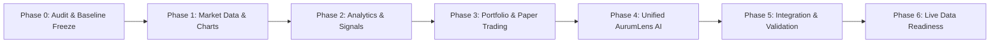

# AurumLens — Implementation Phases & Roadmap Specification v3.0

> **Version:** 3.0 · **Date:** 2026-10-20 · **Status:** Master Execution Plan  
> **Supersedes:** Phase Plan v2.0 · **Aligned with:** `prompt.md` Section 10

---

## 1. Execution Philosophy & Priority Tags

Work proceeds sequentially through 7 disciplined phases (Phase 0 to Phase 6). Each phase establishes concrete deliverables, automated test requirements, and a formal exit gate.

### Priority Classifications:
- **`[CORE]`**: Mandatory functionality required for baseline quantitative integrity and prototype demonstration.
- **`[MVP+]`**: Essential usability and transparency features defined in the v3 product scope.
- **`[STRETCH]`**: Advanced extensions delivered only after prior phases achieve 100% exit-gate compliance.

---

## 2. Phase-by-Phase Execution Roadmap

---

### Phase 0 — Repository and Product Audit
**Objective:** Establish a rock-solid, verified baseline of existing code, schemas, and tests before introducing architectural upgrades.

- **Tasks:**
  - `[CORE]` Audit existing Python quant engine (`engine/src/aurumlens/`), test suite (117 tests), FastAPI service, and Next.js 14 frontend.
  - `[CORE]` Verify the canonical **Facts Register** (`config/contracts.yaml`): contract trading units, quote bases, purities, expiry cycles, and tender window definitions.
  - `[CORE]` Maintain strict `spec_mode` controls (handling `DISPUTED` status for GOLDGUINEA purity).
  - `[CORE]` Verify historical MCX Bhavcopy parser adapters across both legacy (pre-Oct 2023) and modern TCS CDP eras.
  - `[CORE]` Enforce zero-leak security posture via automated secrets scanning (`scripts/scan_secrets.py`).
  - `[CORE]` Audit all 27 PRD baseline requirements via automated compliance script (`scripts/verify_fr_checklist.py`).
- **Deliverables:**
  - Clean baseline commit with 117+ unit tests passing in $< 10\text{ seconds}$.
  - Verified Facts Register and frozen configuration models (`contracts.yaml`, `costs.yaml`, `strategy.yaml`).
- **Exit Gate:** Automated rehearsal passes 3 consecutive rounds (`python scripts/rehearse_demo.py`) with zero P1 defects.

---

### Phase 1 — Reliable Market Data and Interactive Charts
**Objective:** Deliver an uncompromised market data layer and interactive chart component visualizing raw and normalized prices.

- **Tasks:**
  - `[CORE]` Standardize market data schemas: `contracts`, `market_data_daily`, and `candle_ticks`.
  - `[CORE]` Implement price quality pipeline: source selection (settlement vs close) and `SUSPECT` flagging (low volume, low OI, price gaps).
  - `[CORE]` Implement stale feed detection: raise UI warnings when exchange updates lag schedule.
  - `[CORE]` Build interactive Candlestick & Volume chart component accepting application-supplied JSON datasets.
  - `[CORE]` Build Dual-Mode Toggle: switch effortlessly between raw exchange prices and normalized ₹/10g 999 equivalent prices.
  - `[MVP+]` Implement relative spread and statistical deviation windows displaying rolling mean $\mu_{t-1}$ and $\pm 2\sigma_{t-1}$ bands.
  - `[MVP+]` Support multi-timeframe controls (1D, 1W, 1M, 6M, 1Y, All) with smooth pan/zoom and crosshair tooltips.
  - `[MVP+]` Render explicit loading skeletons, empty data states, and data status badges (`Historical`, `Delayed 15m`, `Simulated`).
- **Deliverables:**
  - Fully functional Next.js Interactive Chart suite connected to verified historical Parquet/DuckDB backend data.
  - Test suite covering price quality evaluator and candle formatting.
- **Exit Gate:** Chart renders 5 years of daily data smoothly across all 4 contracts; raw vs normalized toggle verified mathematically.

---

### Phase 2 — Analytics Verification and Explainable Signals
**Objective:** Confirm relative-value quant algorithms, 12-gate waterfall evaluator, and explainability records.

- **Tasks:**
  - `[CORE]` Verify price normalization formula $P \times (10/\text{basis}) \times (0.999/\text{purity})$ with purity direction test.
  - `[CORE]` Verify smallest calendar gap expiry pairing algorithm ($\Delta T \le 35\text{ days}$).
  - `[CORE]` Implement curve carry calculation $r_{\text{curve}}$ with graceful fallback to $r_{\text{fallback}}$ and source labeling.
  - `[CORE]` Implement adjusted log spread and rolling Z-score / MAD deviation using history through $t-1$ strictly.
  - `[CORE]` Verify integer lot-ratio sizer minimizing unhedged residual fine gold grams.
  - `[CORE]` Apply itemized statutory transaction friction (brokerage, exchange, SEBI, sell-only CTT, buy-only stamp, GST).
  - `[CORE]` Implement Corwin-Schultz (2012) bid-ask spread estimator with configurable fallback bps.
  - `[CORE]` Execute the complete **12-Gate Waterfall Evaluator**: evaluate all gates simultaneously, storing margins and reason codes.
  - `[CORE]` Build Nearest-Miss service: rank non-alerting pairs by gates passed and narrowest failing ratio.
  - `[MVP+]` Generate bilingual plain English and Hindi signal explanations.
  - `[MVP+]` Enforce regex `NumericGuard` auditing all generated explanation strings.
- **Deliverables:**
  - Complete signal pipeline outputting binary `ALERT` or `QUIET` decisions with full evidence dossiers.
  - Comprehensive unit test suite covering hand fixtures (GOLDM ₹120,482.41, Nov-5 pairing, 4:5 lot ratio).
- **Exit Gate:** 100% of analytical unit tests pass; constant basis offset never alerts; zero look-ahead bias confirmed.

---

### Phase 3 — Portfolio Management and Paper Trading Simulation
**Objective:** Provide a realistic simulated trading environment to evaluate hypothetical trades and monitor portfolio risk.

- **Tasks:**
  - `[CORE]` Implement simulated portfolio ledger: cash balance, margin utilization, open positions, and realized/unrealized P&L.
  - `[CORE]` Implement Two-Phase Staged Order Flow: stage candidate paper trades requiring explicit user confirmation before commitment.
  - `[CORE]` Record entry price, adverse slippage fill, itemized round-trip fees, and residual fine gold exposure on every position.
  - `[CORE]` Implement Mark-to-Market (MTM) calculation engine updating only when valid market prices exist.
  - `[CORE]` Implement trade closure engine recording exit reasons (`CONVERGENCE`, `STOP_LOSS`, `EXPIRY_WINDOW`, `USER_CLOSED`).
  - `[MVP+]` Build Portfolio Risk Controls: enforce max risk per trade (e.g. 2% of equity) and max portfolio notional exposure.
  - `[MVP+]` Implement What-If Scenario Stress Testing: simulate user-defined price shocks (e.g. -2% gold move) and carry spikes.
  - `[MVP+]` Construct walk-forward backtesting engine with expanding window folds, baseline benchmarking, and Deflated Sharpe Ratio (DSR).
- **Deliverables:**
  - Complete Paper Trading and Portfolio Snapshot UI in Next.js.
  - Deterministic portfolio reconciliation service matching all transactions to recorded fees.
- **Exit Gate:** Simulated portfolio reconciles cash, fees, and P&L with 100% precision; what-if stress tester calculates accurate delta exposure.

---

### Phase 4 — Unified AurumLens AI Chatbot
**Objective:** Deploy a single conversational AI assistant ("AurumLens AI") unifying trading education, signal explainability, and paper portfolio management.

- **Tasks:**
  - `[CORE]` Build single conversational interface (dockable slide-over / expandable drawer) embedded in the dashboard.
  - `[CORE]` Implement autonomous Intent Classifier routing queries across Education, Market Analysis, Portfolio, and Simulation.
  - `[CORE]` Construct approved deterministic Tool Registry:
    - `get_market_overview`
    - `get_contract_metadata`
    - `get_pair_analysis`
    - `get_signal_evidence`
    - `get_nearest_misses`
    - `get_portfolio_summary`
    - `get_open_positions`
    - `simulate_risk_scenario`
    - `stage_paper_order`
  - `[CORE]` Implement Grounding Prompt & Strict NumericGuard post-processor: verify that all emitted numbers exist in backend tool JSON.
  - `[CORE]` Enforce mandatory timestamp and data status labels on every market statement.
  - `[CORE]` Implement interactive Staged Paper Order confirmation cards in the chat UI.
  - `[MVP+]` Support multi-turn conversational context memory (remembering active pair, timeframe, and user portfolio).
  - `[MVP+]` Add graceful degraded responses for stale market feeds and out-of-scope broker execution requests.
- **Deliverables:**
  - Working AurumLens AI chatbot dock integrated into Next.js frontend and FastAPI microservice.
  - Automated test suite validating intent routing, tool execution, and NumericGuard rejection of ungrounded numbers.
- **Exit Gate:** Chatbot answers all benchmark user queries accurately; zero financial hallucinations; trade confirmation cards render reliably.

---

### Phase 5 — System Integration, Security & Performance Validation
**Objective:** Harden the end-to-end multi-tier stack, enforce security policies, and validate performance benchmarks.

- **Tasks:**
  - `[CORE]` Verify Row Level Security (RLS) policies on Supabase PostgreSQL: anon client restricted to read-only; user portfolio records strictly isolated.
  - `[CORE]` Audit client-side bundles: assert zero service-role keys or private credentials exist in `web/`.
  - `[CORE]` Execute secrets scan across 100% of repository files.
  - `[CORE]` Enforce rate limiting and abuse controls on API and chatbot endpoints.
  - `[CORE]` Validate system performance metrics:
    - FastAPI tool endpoints response time $< 150\text{ ms}$.
    - Daily signal generation across all pairs $< 3\text{ seconds}$.
    - Full 5-year walk-forward backtest $< 60\text{ seconds}$.
  - `[CORE]` Conduct accessibility audit: ensure WCAG 2.1 AA compliance, keyboard navigation, and color-independent alert badges.
- **Deliverables:**
  - Comprehensive verification checklist report and updated demo runbook.
  - Production-ready Docker packaging and one-click launch scripts (`run_demo.bat` / `run_demo.ps1`).
- **Exit Gate:** Automated rehearsal passes 3 consecutive offline passes with 100% pass rate across unit tests, security scans, and build tasks.

---

### Phase 6 — Live Data Readiness (Future Production Tier)
**Objective:** Prepare data architecture for authorized real-time market data vendor integration.

- **Tasks:**
  - `[MVP+]` Formalize vendor selection criteria for authorized Indian market data providers (TruData, Global DataFeeds).
  - `[MVP+]` Establish data licensing compliance: differentiate Display vs Non-Display vs Derived Data usage.
  - `[MVP+]` Design WebSocket feed ingestion service with heartbeat monitoring, automatic reconnects, and sequence gap recovery.
  - `[STRETCH]` Build automated feed reconciliation engine comparing live tick data against official end-of-day settlement files.
- **Deliverables:**
  - Live data ingestion abstraction layer and licensing audit report (`DataSourcesAndLicensing.md`).
- **Exit Gate:** Real-time data pipeline architecture fully documented; exchange compliance guidelines established.
