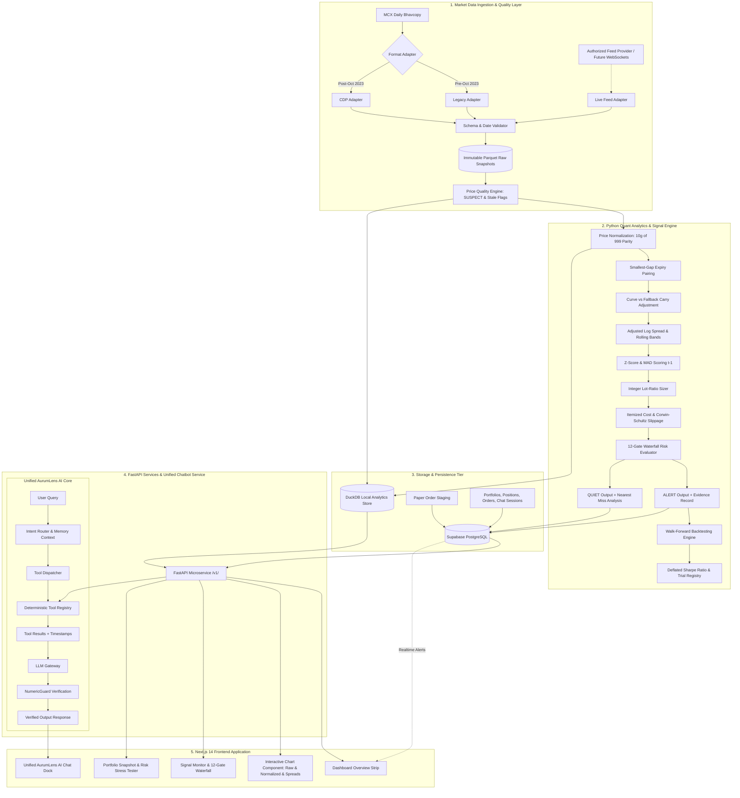

# AurumLens — System Architecture Specification v3.0

> **Version:** 3.0 · **Date:** 2026-10-20 · **Status:** Master Architecture  
> **Supersedes:** System Architecture v2.0 · **Aligned with:** `prompt.md`

---

## 1. High-Level Architectural Topology

AurumLens is structured as a decoupled, multi-tier quantitative system comprising data ingestion, statistical signal generation, deterministic persistence, an API microservice, a unified conversational agent, and a client-side visualization layer.



---

## 2. Core Subsystems & Components

### 2.1 Ingestion & Data Quality Engine
- **Source Adapters:** Handles schema divergence across MCX eras (Legacy pre-Oct 2023 CSV vs modern TCS CDP platform).
- **Date Validator:** Asserts returned trade date equals requested date. Rejects missing or corrupted holiday files.
- **Price Quality Evaluator:** Assigns `quality_flag = 'SUSPECT'` when:
  - Daily traded volume $< 10$ lots.
  - Open interest $< 50$ lots.
  - Divergence between close and settlement price exceeds configured threshold.
- **Stale Feed Monitor:** Detects timestamps lagging the expected exchange schedule, preventing stale inputs from producing spurious signals.

### 2.2 Quantitative Signal Engine
All financial computations are implemented as **small, pure, testable Python functions** with zero I/O side effects.
1. `normalization.py`: Normalizes quotes to ₹/10g 999 fine gold.
2. `pairing.py`: Identifies active combinations minimizing $|T_A - T_B|$.
3. `carry.py`: Computes annualized carry $r_{\text{curve}} = \ln(P_{\text{far}}/P_{\text{near}})/(\Delta T/365)$ or falls back to configured rate.
4. `spread.py`: Computes $s_t = \ln(P_A) - \ln(P_B) + \text{carry}$, rolling mean $\mu_{t-1}$, rolling standard deviation $\sigma_{t-1}$, and $z_t$.
5. `sizing.py`: Searches integer lot space $1 \le n_A, n_B \le \text{max\_lots}$ to minimize $|n_A g_A - n_B g_B|$.
6. `costs.py` & `slippage.py`: Applies itemized MCX transaction friction (brokerage, exchange, SEBI, sell-side CTT, buy-side stamp, GST) and Corwin-Schultz (2012) bid-ask spread estimates.
7. `gates.py`: Evaluates all 12 gates simultaneously, storing margin and reason codes.
8. `nearest_miss.py`: Ranks non-alerting pairs by $(N_{\text{passed}} \downarrow, \min \text{ratio} \downarrow)$.

### 2.3 Walk-Forward Backtester & Attribution Engine
- **Expanding Window Fold Splitter:** Partitions historical data into in-sample optimization and out-of-sample holdout folds.
- **Execution Simulator:** Executes signals at $t+1$ with simulated adverse slippage $P \times (1 \pm S/2)$.
- **Attribution Breakdown:** Isolates Gross Spread P&L, Transaction Friction, Slippage Drag, Net Arbitrage P&L, and Residual Gold Exposure Delta P&L.
- **Deflated Sharpe Ratio (DSR):** Computes haircut for selection bias across trial count $N_{\text{trials}}$.

### 2.4 Paper Trading & Portfolio Management Subsystem
- **Simulated Order Staging:** Stores candidate trade requests pending user confirmation.
- **Position Ledger:** Tracks active paper positions, mark-to-market valuations, realized gains/losses, and stop-loss/take-profit triggers.
- **Risk Monitor:** Enforces max capital allocation per trade, max portfolio exposure, and concentration limits.
- **Stress-Testing Engine:** Evaluates "what-if" market scenarios (e.g. adverse 2% gold shock, 50bps carry widening) against active positions.

### 2.5 Unified AI Chatbot Microservice ("AurumLens AI")
- **Intent Router:** Analyzes user input to route across Educational, Market Analysis, Portfolio, and Simulation domains.
- **Context Memory Manager:** Tracks conversational thread, active pair, timeframe, and selected contract without retaining personal secrets.
- **Approved Tool Dispatcher:** Executes verified Python tools.
- **NumericGuard Post-Processor:** Audits generated text with regular expressions against source tool JSON data. If any ungrounded figure is detected, the response is discarded and re-rendered via safe deterministic templates.

---

## 3. Unified Chatbot Tool Registry & System Boundaries

The chatbot interacts with the platform strictly via predefined, authenticated tools:

```
┌────────────────────────────────────────────────────────────────────────┐
│                   AURUM LENS AI TOOL REGISTRY                          │
├────────────────────────────┬─────────────────────────────┬─────────────┤
│ Tool Identifier            │ Purpose                     │ Permission  │
├────────────────────────────┼─────────────────────────────┼─────────────┤
│ `get_market_overview`      │ Fetch latest market status  │ Public/Read │
│ `get_contract_metadata`    │ Fetch specs & facts status  │ Public/Read │
│ `get_pair_analysis`        │ Fetch spread, z-score, gates│ Public/Read │
│ `get_signal_evidence`      │ Fetch full 12-gate evidence │ Public/Read │
│ `get_nearest_misses`       │ Fetch ranked quiet pairs    │ Public/Read │
│ `calculate_cheapest_hedge` │ Compute lowest friction     │ Public/Read │
│ `calculate_parity_convert` │ Normalization converter     │ Public/Read │
│ `calculate_lot_ratio`      │ Integer lot sizing          │ Public/Read │
│ `get_portfolio_summary`    │ Fetch user cash, MTM, P&L   │ User-Scoped │
│ `get_open_positions`       │ List active paper positions │ User-Scoped │
│ `simulate_risk_scenario`   │ Run what-if stress tests    │ User-Scoped │
│ `stage_paper_order`        │ Prepare pending paper trade │ User-Confirm│
│ `close_paper_position`     │ Stage closing paper trade   │ User-Confirm│
└────────────────────────────┴─────────────────────────────┴─────────────┘
```

### Critical Chatbot Boundaries:
1. **Zero Direct Database Mutation:** The AI chatbot can NEVER directly execute SQL `UPDATE`, `INSERT`, or `DELETE`.
2. **Two-Step Confirmation for Mutations:** When a user requests a simulated trade (`stage_paper_order` or `close_paper_position`), the tool generates a pending order token and presents an interactive UI confirmation widget. The trade is only committed when the human user clicks "Confirm".
3. **No Financial Hallucination:** The LLM prompt explicitly instructs the model: *"You do not calculate numbers. You report values returned by tools. If a tool returns null or unavailable, state that the metric is unavailable."*

---

## 4. Data Flow Architectures

### 4.1 Daily Signal Generation Flow
```
[MCX Bhavcopy] 
      │ (Download & SHA-256)
      ▼
[Raw Parquet Snapshot] ──▶ [Validator] ──▶ [Price Quality Check]
                                                  │
                                                  ▼
                                       [Normalization Engine]
                                                  │
                                                  ▼
                                       [Expiry Matching Engine]
                                                  │
                                                  ▼
                                       [Carry & Spread Engine]
                                                  │
                                                  ▼
                                       [12-Gate Waterfall]
                                       ┌──────────┴──────────┐
                                       ▼                     ▼
                                   [ALERT]                [QUIET]
                                       │                     │
                             [Evidence Record]       [Nearest Miss]
                                       └──────────┬──────────┘
                                                  ▼
                                       [Supabase / Postgres]
                                                  │ (Realtime Broadcast)
                                                  ▼
                                       [Next.js Client UI]
```

### 4.2 Chatbot Query & Verification Flow
```
User: "Why was the GOLDTEN-GOLDGUINEA signal blocked on Oct 1st?"
      │
      ▼
[Intent Classifier] ──▶ Identifies: `get_signal_evidence`
      │
      ▼
[Tool Execution] ──▶ Calls `get_signal_evidence("GOLDTEN_GOLDGUINEA", "2026-10-01")`
      │
      ▼
[Deterministic Engine Output]:
{
  "status": "QUIET",
  "zscore": 1.67,
  "threshold": 2.00,
  "failing_gates": ["Z_SCORE_THRESHOLD"],
  "timestamp": "2026-10-01 15:45:00 IST"
}
      │
      ▼
[LLM Response Generation with Grounding Prompt]
      │
      ▼
[NumericGuard Verification]:
Regex extracts all numbers from draft response: [1.67, 2.00, 15:45, 2026].
Asserts all numbers exist in tool output JSON.
      │
      ├──▶ [Pass] ──▶ Render to User with timestamp badge
      └──▶ [Fail] ──▶ Fallback to verified template
```

---

## 5. Security & Boundary Architecture

1. **Service-Role vs Anon Key Isolation:**
   - The Python backend uses `SUPABASE_SERVICE_ROLE_KEY` (kept strictly in server `.env`).
   - The Next.js frontend only receives `NEXT_PUBLIC_SUPABASE_ANON_KEY`.
   - Browser client queries are strictly governed by Postgres **Row Level Security (RLS)** allowing `SELECT` on public market signals, and user-scoped `SELECT/INSERT/UPDATE` on personal portfolios.
2. **Formula Isolation:**
   - No analytical calculations in Next.js React components.
   - No analytical formulas in SQL views.
   - All financial logic resides in `engine/src/aurumlens/`.
3. **Audit Trail:**
   - Every signal row records `config_version` (hash of strategy config) and `dataset_version`.
   - Any modification to market data or parameters generates a permanent trace in the audit log.
