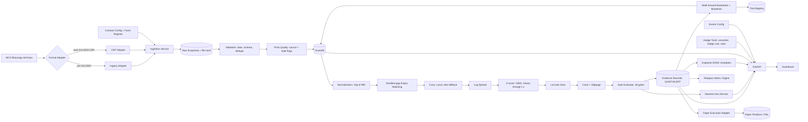
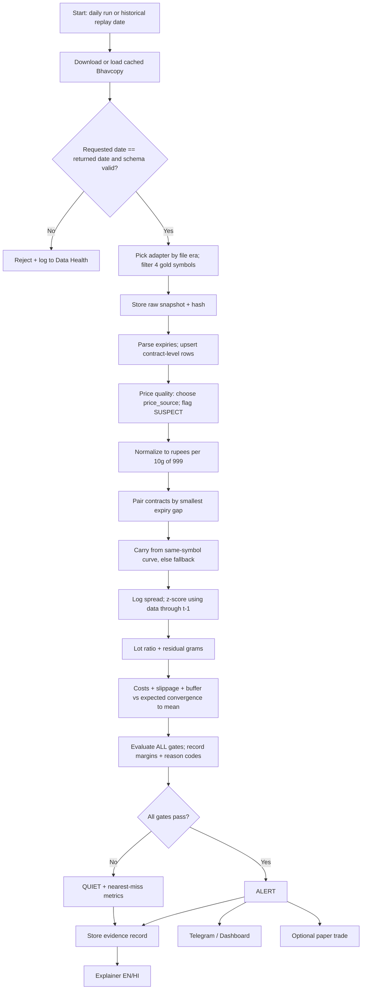
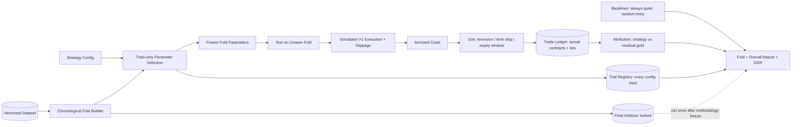
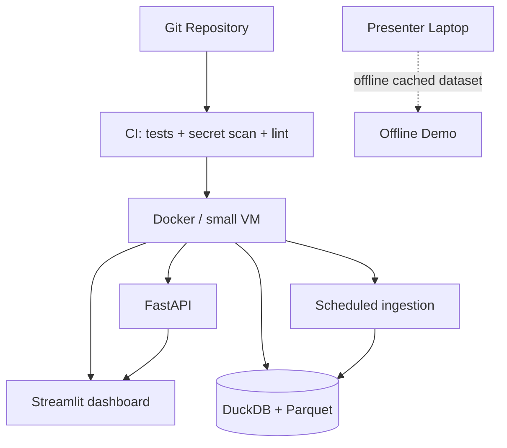
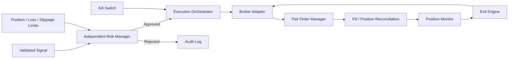

# AurumLens — System Architecture v2.0

> **Version:** 2.0 · **Date:** 2026-10-01 · **Supersedes:** v1
>
> **What v2 adds:**
> - source-format adapters for before and after the October 2023 migration;
> - a price-quality stage;
> - a carry source hierarchy;
> - a sizing engine;
> - a gate evaluator that runs every gate;
> - a nearest-miss service;
> - hedge tools;
> - a deterministic explainer;
> - an events config;
> - a trial registry.
>
> **Storage stays DuckDB + Parquet.**

## 1. High-Level Architecture

## 2. Daily / Replay Workflow

Gate evaluation order is fixed for display. All gates are always evaluated:

| # | Gate | Fail reason code(s) |
|---|---|---|
| 1 | Spec status (per `spec_mode`) | `SPEC_UNVERIFIED` |
| 2 | Data validity | `DATA_INVALID` |
| 3 | Price quality | `PRICE_SUSPECT_A`, `PRICE_SUSPECT_B` |
| 4 | Expiry pair | `NO_EXPIRY_PAIR`, `EXPIRY_GAP_TOO_WIDE` |
| 5 | Carry | `CARRY_FALLBACK` (warning, or a fail if `block_on_carry_fallback`) |
| 6 | History sufficiency | `INSUFFICIENT_HISTORY` |
| 7 | Anomaly threshold | `BELOW_THRESHOLD` |
| 8 | Liquidity | `LIQUIDITY_VOL_A/B`, `LIQUIDITY_OI_A/B` |
| 9 | Expiry/tender safety | `EXPIRY_UNSAFE_A/B` |
| 10 | Cost hurdle | `COST_HURDLE_FAIL` |
| 11 | Duplicate suppression | `DUPLICATE_SUPPRESSED` |

## 3. Backtesting Architecture

## 4. Layer Responsibilities

| Layer | Responsibility |
|---|---|
| Data source | Public daily contract-level Bhavcopy archives |
| Format adapters | Isolate era-specific file names, columns and date formats (legacy and CDP). Each outputs one canonical schema |
| Ingestion | Download, cache, hash, parse, validate, reject and log. Raw evidence is never mutated |
| Price quality | Choose the price source and flag stale or suspect prices |
| Storage | DuckDB for analytics; Parquet for immutable snapshots and versioned datasets |
| Quant | Normalization, pairing, carry, log spread, score, sizing, costs, slippage. All pure functions |
| Decision | Gate evaluator (all gates), dedupe, nearest miss, evidence records |
| Validation | Walk-forward backtest, baselines, attribution, Deflated Sharpe Ratio, trial registry |
| Tools | Converter, cheapest-to-hedge and lot sizer. Each reuses the quant functions with no new formulas |
| Explanation | Deterministic English/Hindi templates over evidence JSON; optional LLM rewrite behind a numeric guard |
| Service | FastAPI: versioned read endpoints plus token-protected admin actions |
| Presentation | Dashboard with nine screens, replay, watermark and disclaimer |
| Alerts | Telegram alerts (and an optional daily digest) behind an interface |
| Paper execution | Simulates the two-leg lifecycle and never calls a broker |

## 5. Data Lineage
Every displayed number resolves along this chain:

`source file (hash) → raw row → canonical daily_price row → normalized row → pair_daily row → gate_result rows → evidence record (config_version, dataset_version)`

The Evidence export (FR27) prints this chain.

## 6. Deployment

UI default: **Streamlit**. It is fastest to build for nine screens. Next.js is an alternative only if the team is already strong in React; the API contract is the same either way.

## 7. Security Boundary
- Public clients receive read-only analytical data.
- Refresh and backtest admin actions require a secret token from an environment variable, and are rate-limited.
- Secrets stay in environment variables, never in the repo.
- Symbols come from an allow-list. Date ranges and tool inputs (grams, lots) are bounded.
- No raw SQL or code is built from user input.
- The explainer receives structured evidence JSON only, never free user prompts. LLM output must pass the numeric guard.

## 8. Future Live-Execution Architecture (post-MVP)

The analytical engine must never call a broker directly.
