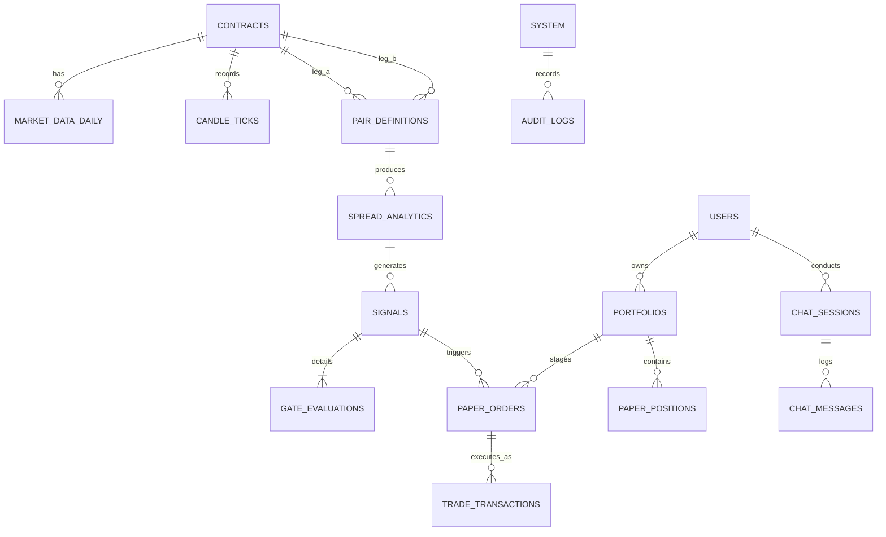

# AurumLens — Data Model & Schema Specification v3.0

> **Version:** 3.0 · **Date:** 2026-10-20 · **Status:** Master Schema Specification  
> **Target Databases:** PostgreSQL 15+ (Supabase) & DuckDB 0.9+ · **Aligned with:** `prompt.md`

---

## 1. Entity-Relationship Overview



---

## 2. Market Data & Contract Specifications

### 2.1 `contracts` (Contract Master)
Stores canonical exchange metadata for every supported gold derivative.

```sql
CREATE TABLE contracts (
    contract_id VARCHAR(64) PRIMARY KEY,              -- e.g. 'GOLDM_20261105'
    symbol VARCHAR(32) NOT NULL,                      -- 'GOLDM', 'GOLDTEN', 'GOLDGUINEA', 'GOLDPETAL'
    display_name VARCHAR(64) NOT NULL,                -- 'Gold Mini Nov-2026'
    trading_unit_g NUMERIC(10, 2) NOT NULL,          -- 100.00, 10.00, 8.00, 1.00
    quote_basis_g NUMERIC(10, 2) NOT NULL,            -- 10.00, 10.00, 8.00, 1.00
    purity NUMERIC(6, 4) NULL,                        -- 0.9950 or 0.9990 (null if DISPUTED)
    purity_candidates NUMERIC(6, 4)[] NULL,           -- ARRAY[0.9950, 0.9990] for GOLDGUINEA
    expiry_date DATE NOT NULL,                        -- Date of expiration
    tender_start_date DATE NOT NULL,                  -- 5 trading days prior to expiry
    tick_size NUMERIC(8, 2) NOT NULL DEFAULT 1.00,   -- Minimum price fluctuation in INR
    spec_status VARCHAR(32) NOT NULL DEFAULT 'TO_VERIFY', -- 'VERIFIED_OFFICIAL' | 'SECONDARY' | 'DISPUTED' | 'TO_VERIFY'
    is_active BOOLEAN NOT NULL DEFAULT TRUE,
    created_at TIMESTAMPTZ NOT NULL DEFAULT NOW(),
    updated_at TIMESTAMPTZ NOT NULL DEFAULT NOW()
);

CREATE INDEX idx_contracts_symbol_expiry ON contracts(symbol, expiry_date);
```

### 2.2 `market_data_daily` (Daily Settlement / EOD Records)
Stores immutable day-end exchange Bhavcopy observations.

```sql
CREATE TABLE market_data_daily (
    id BIGSERIAL PRIMARY KEY,
    contract_id VARCHAR(64) NOT NULL REFERENCES contracts(contract_id),
    trade_date DATE NOT NULL,
    open NUMERIC(12, 2) NOT NULL,
    high NUMERIC(12, 2) NOT NULL,
    low NUMERIC(12, 2) NOT NULL,
    close NUMERIC(12, 2) NOT NULL,
    settlement NUMERIC(12, 2) NULL,
    price_used NUMERIC(12, 2) NOT NULL,                -- Settlement if available/configured, else Close
    normalized_price_10g_999 NUMERIC(14, 4) NOT NULL,  -- P_used * (10/basis) * (0.999/purity)
    volume_lots INT NOT NULL DEFAULT 0,
    open_interest_lots INT NOT NULL DEFAULT 0,
    turnover_inr NUMERIC(18, 2) NOT NULL DEFAULT 0.00,
    source_file_hash VARCHAR(64) NOT NULL,             -- SHA-256 of raw Bhavcopy
    data_status VARCHAR(20) NOT NULL DEFAULT 'HISTORICAL', -- 'LIVE' | 'DELAYED' | 'HISTORICAL' | 'SIMULATED'
    is_suspect BOOLEAN NOT NULL DEFAULT FALSE,
    suspect_reasons TEXT[] NULL,                       -- e.g. ARRAY['LOW_VOLUME', 'PRICE_GAP']
    created_at TIMESTAMPTZ NOT NULL DEFAULT NOW(),
    CONSTRAINT uq_contract_trade_date UNIQUE (contract_id, trade_date)
);

CREATE INDEX idx_mdd_date_contract ON market_data_daily(trade_date, contract_id);
```

### 2.3 `candle_ticks` (Intraday & Historical Bars)
Used by the Interactive Chart Component for multi-timeframe visualization.

```sql
CREATE TABLE candle_ticks (
    id BIGSERIAL PRIMARY KEY,
    contract_id VARCHAR(64) NOT NULL REFERENCES contracts(contract_id),
    timeframe VARCHAR(8) NOT NULL,                     -- '1m', '5m', '15m', '1h', '1d'
    timestamp TIMESTAMPTZ NOT NULL,
    open NUMERIC(12, 2) NOT NULL,
    high NUMERIC(12, 2) NOT NULL,
    low NUMERIC(12, 2) NOT NULL,
    close NUMERIC(12, 2) NOT NULL,
    volume INT NOT NULL DEFAULT 0,
    normalized_close NUMERIC(14, 4) NOT NULL,          -- Standardized ₹/10g 999
    data_status VARCHAR(20) NOT NULL DEFAULT 'HISTORICAL',
    CONSTRAINT uq_candle_series UNIQUE (contract_id, timeframe, timestamp)
);

CREATE INDEX idx_candle_lookup ON candle_ticks(contract_id, timeframe, timestamp DESC);
```

---

## 3. Analytics, Signals & Waterfall Gates

### 3.1 `spread_analytics` (Carry-Adjusted Spread Observations)
```sql
CREATE TABLE spread_analytics (
    id BIGSERIAL PRIMARY KEY,
    pair_name VARCHAR(64) NOT NULL,                    -- e.g. 'GOLDTEN_GOLDM'
    leg_a_contract_id VARCHAR(64) NOT NULL REFERENCES contracts(contract_id),
    leg_b_contract_id VARCHAR(64) NOT NULL REFERENCES contracts(contract_id),
    trade_date DATE NOT NULL,
    expiry_gap_days INT NOT NULL,
    carry_rate NUMERIC(8, 6) NOT NULL,                 -- Annualized carry rate (e.g. 0.065000)
    carry_source VARCHAR(16) NOT NULL,                 -- 'CURVE' | 'FALLBACK'
    carry_adj NUMERIC(10, 6) NOT NULL,                 -- carry_rate * (gap/365)
    log_spread_raw NUMERIC(12, 8) NOT NULL,            -- ln(norm_A) - ln(norm_B)
    log_spread_adj NUMERIC(12, 8) NOT NULL,            -- log_spread_raw + carry_adj
    roll_mean NUMERIC(12, 8) NULL,                     -- 60-day mean through t-1
    roll_std NUMERIC(12, 8) NULL,                      -- 60-day std through t-1
    zscore NUMERIC(8, 4) NULL,                         -- (adj - roll_mean) / roll_std
    mad_score NUMERIC(8, 4) NULL,                      -- Robust MAD score variant
    rich_leg VARCHAR(8) NULL,                          -- 'A' or 'B'
    config_version VARCHAR(64) NOT NULL,
    dataset_version VARCHAR(64) NOT NULL,
    created_at TIMESTAMPTZ NOT NULL DEFAULT NOW(),
    CONSTRAINT uq_pair_date UNIQUE (pair_name, trade_date)
);
```

### 3.2 `signals` (Signal Decisions & Evidence Master)
```sql
CREATE TABLE signals (
    signal_id VARCHAR(64) PRIMARY KEY,                 -- Hash of pair + date + config_version
    pair_name VARCHAR(64) NOT NULL,
    trade_date DATE NOT NULL,
    status VARCHAR(16) NOT NULL,                       -- 'ALERT' | 'QUIET'
    zscore NUMERIC(8, 4) NULL,
    hurdle_z NUMERIC(8, 4) NOT NULL DEFAULT 2.00,
    expected_convergence_inr NUMERIC(12, 2) NOT NULL,  -- Gross mean reversion potential
    total_friction_inr NUMERIC(12, 2) NOT NULL,        -- Sum of itemized costs
    slippage_inr NUMERIC(12, 2) NOT NULL,              -- Corwin-Schultz slippage
    safety_buffer_inr NUMERIC(12, 2) NOT NULL,
    net_expected_edge_inr NUMERIC(12, 2) NOT NULL,     -- Gross - Friction - Slippage - Buffer
    lots_a INT NOT NULL,                               -- Sizing: Leg A lot count
    lots_b INT NOT NULL,                               -- Sizing: Leg B lot count
    residual_fine_g NUMERIC(8, 2) NOT NULL,           -- Residual fine gold unhedged
    gates_passed INT NOT NULL,                         -- Number of gates passing (0 to 12)
    gates_total INT NOT NULL DEFAULT 12,
    blocking_reason_codes TEXT[] NOT NULL,             -- All failing gate codes
    near_miss_min_ratio NUMERIC(6, 4) NULL,            -- Min ratio across failing gates
    spec_mode VARCHAR(16) NOT NULL,                    -- 'strict' | 'research'
    config_version VARCHAR(64) NOT NULL,
    dataset_version VARCHAR(64) NOT NULL,
    created_at TIMESTAMPTZ NOT NULL DEFAULT NOW()
);

CREATE INDEX idx_signals_date_status ON signals(trade_date DESC, status);
```

### 3.3 `gate_evaluations` (12-Gate Waterfall Audit Detail)
```sql
CREATE TABLE gate_evaluations (
    id BIGSERIAL PRIMARY KEY,
    signal_id VARCHAR(64) NOT NULL REFERENCES signals(signal_id) ON DELETE CASCADE,
    gate_name VARCHAR(32) NOT NULL,                    -- e.g. 'Z_SCORE_THRESHOLD', 'EXPIRY_SAFETY'
    passed BOOLEAN NOT NULL,
    measured_value NUMERIC(14, 4) NULL,
    threshold_value NUMERIC(14, 4) NULL,
    margin_value NUMERIC(14, 4) NULL,
    reason_code VARCHAR(32) NOT NULL,                  -- 'PASS' or specific fail code
    display_order INT NOT NULL,
    created_at TIMESTAMPTZ NOT NULL DEFAULT NOW(),
    CONSTRAINT uq_signal_gate UNIQUE (signal_id, gate_name)
);
```

---

## 4. Paper Portfolios & Simulated Trades

### 4.1 `portfolios` (User Simulated Accounts)
```sql
CREATE TABLE portfolios (
    portfolio_id VARCHAR(64) PRIMARY KEY,
    user_id UUID NOT NULL,                             -- Scoped to Supabase Auth user
    account_name VARCHAR(64) NOT NULL DEFAULT 'Simulated Desk',
    initial_cash_inr NUMERIC(14, 2) NOT NULL DEFAULT 1000000.00,
    cash_balance_inr NUMERIC(14, 2) NOT NULL DEFAULT 1000000.00,
    max_risk_per_trade_pct NUMERIC(5, 2) NOT NULL DEFAULT 2.00, -- Risk controls
    max_portfolio_exposure_inr NUMERIC(14, 2) NOT NULL DEFAULT 5000000.00,
    created_at TIMESTAMPTZ NOT NULL DEFAULT NOW(),
    updated_at TIMESTAMPTZ NOT NULL DEFAULT NOW()
);

CREATE INDEX idx_portfolios_user ON portfolios(user_id);
```

### 4.2 `paper_positions` (Active & Closed Simulated Positions)
```sql
CREATE TABLE paper_positions (
    position_id VARCHAR(64) PRIMARY KEY,
    portfolio_id VARCHAR(64) NOT NULL REFERENCES portfolios(portfolio_id),
    signal_id VARCHAR(64) NULL REFERENCES signals(signal_id),
    pair_name VARCHAR(64) NOT NULL,
    status VARCHAR(16) NOT NULL DEFAULT 'OPEN',        -- 'OPEN' | 'CLOSED' | 'CANCELLED'
    
    -- Leg A Details
    leg_a_contract_id VARCHAR(64) NOT NULL REFERENCES contracts(contract_id),
    leg_a_side VARCHAR(8) NOT NULL,                    -- 'BUY' | 'SELL'
    leg_a_lots INT NOT NULL,
    leg_a_entry_price NUMERIC(12, 2) NOT NULL,
    leg_a_current_price NUMERIC(12, 2) NOT NULL,
    leg_a_exit_price NUMERIC(12, 2) NULL,

    -- Leg B Details
    leg_b_contract_id VARCHAR(64) NOT NULL REFERENCES contracts(contract_id),
    leg_b_side VARCHAR(8) NOT NULL,                    -- 'BUY' | 'SELL'
    leg_b_lots INT NOT NULL,
    leg_b_entry_price NUMERIC(12, 2) NOT NULL,
    leg_b_current_price NUMERIC(12, 2) NOT NULL,
    leg_b_exit_price NUMERIC(12, 2) NULL,

    -- Residuals & Economics
    residual_fine_g NUMERIC(8, 2) NOT NULL,
    total_entry_fees_inr NUMERIC(10, 2) NOT NULL,
    total_exit_fees_inr NUMERIC(10, 2) NOT NULL DEFAULT 0.00,
    unrealized_pnl_inr NUMERIC(12, 2) NOT NULL DEFAULT 0.00,
    realized_pnl_inr NUMERIC(12, 2) NOT NULL DEFAULT 0.00,

    -- Risk Triggers
    stop_loss_spread NUMERIC(12, 8) NULL,
    take_profit_spread NUMERIC(12, 8) NULL,
    opened_at TIMESTAMPTZ NOT NULL DEFAULT NOW(),
    closed_at TIMESTAMPTZ NULL,
    exit_reason VARCHAR(32) NULL                       -- 'CONVERGENCE' | 'STOP_LOSS' | 'EXPIRY' | 'USER_CLOSED'
);

CREATE INDEX idx_positions_portfolio ON paper_positions(portfolio_id, status);
```

### 4.3 `paper_orders` (Staged Orders Requiring User Confirmation)
```sql
CREATE TABLE paper_orders (
    order_id VARCHAR(64) PRIMARY KEY,
    portfolio_id VARCHAR(64) NOT NULL REFERENCES portfolios(portfolio_id),
    signal_id VARCHAR(64) NULL REFERENCES signals(signal_id),
    intent_type VARCHAR(16) NOT NULL,                  -- 'OPEN_SPREAD' | 'CLOSE_POSITION'
    target_position_id VARCHAR(64) NULL,              -- Populated if closing
    order_payload JSONB NOT NULL,                      -- Staged legs, lots, and estimated prices
    status VARCHAR(24) NOT NULL DEFAULT 'PENDING_CONFIRMATION', -- 'PENDING_CONFIRMATION' | 'EXECUTED' | 'EXPIRED' | 'REJECTED'
    confirmation_token VARCHAR(64) NOT NULL,
    expires_at TIMESTAMPTZ NOT NULL,                   -- Order staging expires after 5 minutes
    confirmed_at TIMESTAMPTZ NULL,
    created_at TIMESTAMPTZ NOT NULL DEFAULT NOW()
);
```

---

## 5. Unified AI Chatbot & Audit Logs

### 5.1 `chat_sessions` & `chat_messages`
```sql
CREATE TABLE chat_sessions (
    session_id VARCHAR(64) PRIMARY KEY,
    user_id UUID NOT NULL,
    title VARCHAR(128) NOT NULL DEFAULT 'Market Analysis Chat',
    context_pair VARCHAR(64) NULL,
    context_timeframe VARCHAR(16) NULL,
    created_at TIMESTAMPTZ NOT NULL DEFAULT NOW(),
    updated_at TIMESTAMPTZ NOT NULL DEFAULT NOW()
);

CREATE TABLE chat_messages (
    message_id VARCHAR(64) PRIMARY KEY,
    session_id VARCHAR(64) NOT NULL REFERENCES chat_sessions(session_id) ON DELETE CASCADE,
    role VARCHAR(16) NOT NULL,                         -- 'user' | 'assistant' | 'system'
    content TEXT NOT NULL,
    tool_calls JSONB NULL,                             -- Tools executed by assistant
    tool_results JSONB NULL,                           -- Deterministic tool output
    passed_numeric_guard BOOLEAN NOT NULL DEFAULT TRUE,
    data_timestamp TIMESTAMPTZ NOT NULL DEFAULT NOW(),
    created_at TIMESTAMPTZ NOT NULL DEFAULT NOW()
);

CREATE INDEX idx_chat_messages_session ON chat_messages(session_id, created_at ASC);
```

### 5.2 `audit_log` (Immutable Event Ledger)
```sql
CREATE TABLE audit_log (
    event_id BIGSERIAL PRIMARY KEY,
    event_type VARCHAR(64) NOT NULL,                   -- 'SIGNAL_GENERATED' | 'PAPER_TRADE_STAGED' | 'PAPER_TRADE_EXECUTED' | 'CONFIG_MODIFIED'
    actor_id VARCHAR(64) NOT NULL,                     -- 'ENGINE' | user UUID
    payload JSONB NOT NULL,
    prev_hash VARCHAR(64) NULL,                        -- Cryptographic hash chain
    event_hash VARCHAR(64) NOT NULL,
    created_at TIMESTAMPTZ NOT NULL DEFAULT NOW()
);

CREATE INDEX idx_audit_event_type ON audit_log(event_type, created_at DESC);
```
