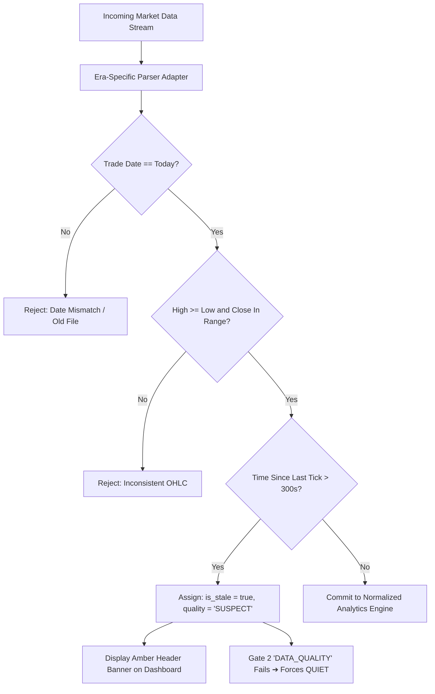

# AurumLens — Market Data Architecture, Charting Integration & Licensing Specification v3.0

> **Version:** 3.0 · **Date:** 2026-10-20 · **Status:** Master Market Data & Licensing Document  
> **Aligned with:** `prompt.md` Section 2.B, 4, 7 & Phase 6

---

## 1. Executive Summary: The Data Independence Mandate

A quantitative commodity intelligence platform is only as trustworthy as its market data pipeline. In India, commodity futures data from the Multi Commodity Exchange (MCX) is strictly governed by exchange circulars and intellectual property frameworks.

### Foundational Principles (Rule R4, R19, R26):
1. **Separation of Visualization from Data Rights:** Charting software (e.g. TradingView widgets) does **not** grant rights to access, store, process, or redistribute underlying exchange tick data.
2. **Provider Independence:** The analytics engine, 12-gate waterfall, portfolio ledger, and unified AI chatbot must remain completely agnostic of any single data vendor.
3. **Explicit Labeling:** All displayed prices must be explicitly labeled as **Live**, **15-Min Delayed**, **EOD Historical**, or **Simulated**. Demo fixtures must never masquerade as live market feeds.

---

## 2. TradingView Integration Analysis & Architectural Choices

`prompt.md` Section 2.B mandates:
> *"Use an embeddable chart widget only as a quick visual component when its limitations fit the requirement. For charts that must display AurumLens-specific data, normalized prices, spread calculations, and custom signal overlays, use a charting component that accepts application-supplied data."*

### Comparison Matrix: Embeddable Widget vs Application-Supplied Charting

| Feature / Dimension | Option A: TradingView Embeddable Widget | Option B: Lightweight Charts / Custom Financial Charting |
|---|---|---|
| **Data Source** | TradingView's proprietary cloud feeds | Application's verified DuckDB / Parquet backend |
| **MCX Gold Coverage** | Raw MCX contracts (GOLDM, GOLDTEN, etc.) | Custom synthesized data (Normalized, Spreads, Z-scores) |
| **Normalized Price Support** | ❌ **Impossible** (Cannot inject ₹/10g 999 formula) | ✅ **Native** (Plots pre-computed analytical values) |
| **Spread & $\pm 2\sigma$ Envelopes** | ⚠️ Partial (Complex Pine Script, no carry adj) | ✅ **Full** (Displays carry-adjusted spread & rolling mean) |
| **Signal & Gate Overlay Markers** | ❌ Not synchronized with database audit records | ✅ **Exact** (Markers correspond to persisted signal IDs) |
| **AI Chatbot Synergy** | ❌ Zero (Chatbot cannot inspect widget canvas) | ✅ **Full** (Chatbot queries same underlying candle records) |
| **Offline / Demo Reliability** | ❌ Fails without active internet & TradingView servers | ✅ **100% Offline Capable** (Loads local cached data) |
| **Exchange Licensing Requirement** | Covered by TradingView for basic web display | Requires AurumLens to secure non-display / derived license |

### Architectural Decision: Dual-Tier Charting Architecture
To achieve optimal presentation for both high-level reference and deep relative-value analysis, AurumLens implements a **Dual-Tier Strategy**:

1. **Tier 1 (Core Analytical Engine): Lightweight Financial Charting Component**
   - Built using TradingView's open-source `lightweight-charts` library or custom high-performance SVG/Canvas charting.
   - Accepts **application-supplied data streams** from FastAPI (`/v1/market/candles`).
   - Powers the Normalized Price view, Carry-Adjusted Spread view, and Statistical Z-Score Deviation window.
   - Directly linked to the AI Chatbot context and persisted database signals.
2. **Tier 2 (Optional Reference): Standalone Embeddable Widget**
   - Available on a secondary tab as a convenient reference for raw MCX gold international spot benchmarks (XAU/USD).
   - Distinctly labeled: `[Third-Party Reference Feed • Not Used in Quant Gating]`.

---

## 3. Market Data Providers: Evaluation for Indian Commodity Markets

For transition from Phase 0–5 (historical Bhavcopy & paper trading) to Phase 6 (live market feeds), AurumLens evaluates authorized Indian data vendors:

### 3.1 Authorized Vendor Comparison

| Vendor | Primary Coverage | API Delivery Mode | Latency Tier | Indicative Cost | Licensing Complexity |
|---|---|---|---|---|---|
| **TruData** (Authorized MCX Vendor) | MCX Gold Futures, Indices | REST + WebSocket (JSON/Protobuf) | Real-time tick & 1-second candles | ~₹3,500 – ₹7,500 / month / desk | Standard display redistribution tier available |
| **Global DataFeeds** (Authorized MCX Vendor) | MCX, NSE, NFO | WebSocket + C++ / Python SDK | Ultra-low latency tick-by-tick | ~₹4,000 – ₹9,000 / month / desk | Direct vendor agreement required |
| **Refinitiv / LSEG** | Global Bullion, MCX | Enterprise FIX / REST | Institutional millisecond | Enterprise ($2,000+ / mo) | High (Requires institutional audit) |
| **Interactive Brokers / Broker APIs** | Global Gold, Indian Gold | WebSocket API | Broker-client execution stream | Requires active funded account | Prohibits redistribution outside account holder |

### 3.2 Evaluation Criteria:
1. **Historical Data Depth:** Must provide clean, unadjusted tick/1-minute historical data spanning at least 5 years.
2. **Contract Metadata Support:** Explicit delivery of lot size, quote unit, expiry date, and official settlement prices.
3. **Connection Reliability:** Automated ping/heartbeat monitoring with sequence number recovery.

---

## 4. Regulatory Framework: MCX Data Licensing Tiers

Redistributing or processing MCX market data requires compliance with SEBI and MCX market data policy circulars:

### 4.1 Data Usage Categorization
- **Category 1: Real-Time Display Data**
  - Live data presented to users with $< 15\text{ minutes}$ latency.
  - Requires an authorized Data Vendor or Sub-Vendor agreement with MCX.
  - User terminals must enforce per-seat authentication and access auditing.
- **Category 2: Delayed Display Data ($\ge 15\text{ Minutes}$)**
  - Prices delayed by at least 15 minutes from exchange dissemination.
  - Lower licensing fee tier; permissible for educational and research platforms with explicit delay disclaimers.
- **Category 3: Non-Display & Algorithmic Calculation Data**
  - Ingestion of market data directly into algorithmic models, risk engines, or automated execution simulators.
  - Mandates a Non-Display Usage license from MCX.
- **Category 4: Derived Analytics & Indexes**
  - Prices transformed such that original raw exchange quotes cannot be reverse-engineered (e.g. Z-scores, anomaly indices, volatility metrics).
  - Derived indices generally enjoy simplified distribution permissions provided the underlying raw price feed is properly licensed.

### 4.2 AurumLens Compliance Posture (MVP vs Production)
- **Phase 0–5 (Current Prototype / MVP):** Operates strictly on **Public End-of-Day MCX Bhavcopy Files** (freely accessible on MCX's public portal for research) and synthetic development fixtures.
- **Phase 6 (Live Deployment):** Requires establishing a formal commercial sub-vendor distribution agreement with an authorized vendor (e.g. TruData) with user-level JWT access gating.

---

## 5. Ingestion Pipeline & Stale Feed Handling

To prevent stale or corrupted market data from producing false arbitrage signals:

### Stale Feed Safeguards:
1. **Timeout Trigger:** If no tick arrives for an active contract during open trading hours for $> 5\text{ minutes}$, the feed status transitions to `STALE`.
2. **Gate 2 Auto-Trip:** The moment a contract's price is marked `STALE` or `SUSPECT`, Gate 2 (`DATA_QUALITY`) immediately evaluates to `FAIL`.
3. **Forced `QUIET`:** This trips the 12-gate waterfall and guarantees that a frozen or lagged feed **CANNOT** produce an `ALERT` signal.
