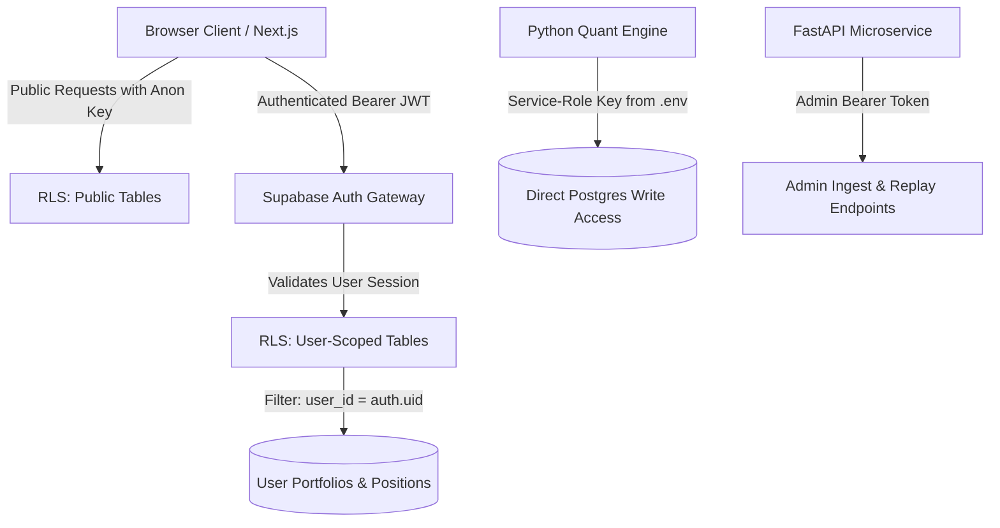

# AurumLens — Security, Authorization & Privacy Architecture v3.0

> **Version:** 3.0 · **Date:** 2026-10-20 · **Status:** Master Security Specification  
> **Aligned with:** `prompt.md` Section 9

---

## 1. Security Architecture Principles

1. **Principle of Least Privilege:** Services, database roles, and frontend clients operate with the minimum permissions required for their tasks.
2. **Zero Secrets in Public Artifacts:** API keys, database credentials, and service tokens must never exist in git repositories, client-visible bundles, or logs.
3. **Defense in Depth:** Security is enforced at multiple independent layers: network boundaries, database Row Level Security (RLS), API parameter bounds checking, and programmatic AI guardrails.
4. **Audit Trail Completeness:** Important state mutations—such as signal generation, simulated paper order creations, parameter modifications, and AI tool executions—are immutably logged with actor identities and cryptographic hashes.

---

## 2. Authentication & Authorization Architecture



### 2.1 User Authentication
- **Provider:** Supabase Auth (OIDC / JWT).
- **Session Tokens:** Short-lived JWTs (1 hour) with secure HTTP-only refresh tokens.
- **Anonymous Sessions:** Visitors without accounts can inspect public market analytics, charts, and public signal evidence records. Authenticated sessions are required to maintain personal paper portfolios and save chat histories.

### 2.2 Row Level Security (RLS) Policies
PostgreSQL RLS is permanently enabled across all public schemas:

| Table | Permitted Role | Allowed Operations | Condition / Filter |
|---|---|---|---|
| `contracts` | `anon`, `authenticated` | `SELECT` | `true` |
| `market_data_daily` | `anon`, `authenticated` | `SELECT` | `true` |
| `candle_ticks` | `anon`, `authenticated` | `SELECT` | `true` |
| `signals` | `anon`, `authenticated` | `SELECT` | `true` |
| `gate_evaluations` | `anon`, `authenticated` | `SELECT` | `true` |
| `portfolios` | `authenticated` | `SELECT`, `UPDATE` | `user_id = auth.uid()` |
| `paper_positions` | `authenticated` | `SELECT` | `portfolio_id IN (SELECT portfolio_id FROM portfolios WHERE user_id = auth.uid())` |
| `paper_orders` | `authenticated` | `SELECT`, `INSERT` | `portfolio_id IN (SELECT portfolio_id FROM portfolios WHERE user_id = auth.uid())` |
| `chat_sessions` | `authenticated` | `SELECT`, `INSERT`, `DELETE`| `user_id = auth.uid()` |
| `chat_messages` | `authenticated` | `SELECT`, `INSERT` | `session_id IN (SELECT session_id FROM chat_sessions WHERE user_id = auth.uid())` |
| *All Tables* | `service_role` | `ALL` | Full bypass for Python backend pipeline only |

*Core Rule:* The browser client uses strictly the publishable `anon` key. No browser client is ever granted write access to market data or signals.

---

## 3. Secrets Management & Credential Isolation

### 3.1 Credential Topology
- **Production Secrets:** Kept exclusively in root `.env` (excluded by `.gitignore`).
- **Placeholder Templates:** `.env.example` contains only empty string placeholders, never real keys or test passwords.
- **Client Bundles:** Next.js environment variables starting with `NEXT_PUBLIC_` are audited to ensure only `NEXT_PUBLIC_SUPABASE_URL` and `NEXT_PUBLIC_SUPABASE_ANON_KEY` are exposed.

### 3.2 Automated Secrets Scanner (`scripts/scan_secrets.py`)
AurumLens maintains an automated repository scanner that executes on pre-commit and CI pipelines:
- Scans all `.py`, `.ts`, `.tsx`, `.json`, `.yaml`, and `.md` files.
- Regex heuristics identify:
  - Supabase Service Role JWTs (`eyJh...`)
  - Telegram Bot API Tokens (`bot[0-9]+:...`)
  - Google Cloud / Gemini API Keys (`AIzaSy...`)
  - RSA/EC Private Key Headers (`-----BEGIN ... PRIVATE KEY-----`)
- Asserts that the string `service_role` NEVER appears in any file within the `web/` frontend directory.

---

## 4. AI Chatbot Permissions & Guardrails

### 4.1 Read vs Write Tool Classification
The unified chatbot interface enforces strict permission segregation:

```
┌────────────────────────────────────────────────────────┐
│                   TOOL PERMISSION MATRIX               │
├────────────────────────────┬─────────────┬─────────────┤
│ Tool Category              │ Operations  │ Execution   │
├────────────────────────────┼─────────────┼─────────────┤
│ Public Market Queries      │ Read-Only   │ Immediate   │
│ Signal Evidence Lookup     │ Read-Only   │ Immediate   │
│ Educational Explanations   │ Read-Only   │ Immediate   │
│ User Portfolio Summary     │ Read-Only   │ Scoped JWT  │
│ What-If Risk Simulations   │ Read-Only   │ Scoped JWT  │
│ Stage Simulated Order      │ Mutating    │ Two-Phase UI│
│ Close Simulated Position   │ Mutating    │ Two-Phase UI│
└────────────────────────────┴─────────────┴─────────────┘
```

### 4.2 The Two-Phase Confirmation Flow (Prompt Injection Defense)
To prevent adversarial prompt injections from liquidating or creating unauthorized trades:
1. When an order creation is requested, the chatbot generates a **Stage Token** (`ord_stage_xxx`) with a 5-minute TTL.
2. The bot does NOT commit the order to `paper_positions`.
3. The frontend renders an interactive confirmation dialog with explicit order parameters (contracts, lots, estimated friction, fine gold delta).
4. The user must manually click **"Confirm Paper Trade"**, which sends an authenticated `POST /v1/paper/confirm` request directly to the backend.

### 4.3 Input Sanitization & Anti-Abuse
- User queries to the chatbot are capped at 500 characters.
- Chat API endpoints are rate-limited to 20 requests per minute per authenticated user (5 requests/min for anonymous IP addresses).
- Retrieval-Augmented Generation (RAG) documents and market feeds are treated as untrusted data and parsed through Pydantic validators.

---

## 5. Audit Logging & Event Integrity

All sensitive operations produce immutable entries in `audit_log`:

```sql
INSERT INTO audit_log (event_type, actor_id, payload, event_hash)
VALUES (
    'PAPER_TRADE_EXECUTED',
    'usr_8f12a9',
    '{"position_id": "pos_9912", "pair": "GOLDTEN_GOLDGUINEA", "lots": [4, 5]}',
    encode(sha256('...'), 'hex')
);
```

### Logged Event Types:
- `MARKET_DATA_INGESTED`: Raw file SHA-256 and row counts recorded.
- `SIGNAL_GENERATED`: Binary decision, 12-gate margins, and config hash stored.
- `PAPER_TRADE_STAGED`: Proposed order staged with user ID and token.
- `PAPER_TRADE_EXECUTED`: User confirmed trade executed at validated price.
- `ADMIN_CONFIG_MODIFIED`: Strategy or cost config changes recorded.
- `CHATBOT_TOOL_INVOKED`: Tool name, parameters, execution latency, and NumericGuard result logged.

---

## 6. Regulatory & Financial Compliance Boundaries

1. **"Analytics Only" Disclaimer Mandate:**
   - The phrase *"Analytics only — not investment advice"* is displayed permanently across:
     - The global footer of every dashboard page.
     - The header of every chatbot session.
     - The summary section of all exported CSV/HTML evidence dossiers.
2. **Simulated Labeling:**
   - All portfolio balances, paper positions, and backtest results are prominently stamped with `SIMULATED / RESEARCH ONLY`.
3. **No Execution Adapter to Real Broker APIs:**
   - Broker APIs (Zerodha Kite, Upstox, Interactive Brokers) are excluded from the repository. The paper adapter connects solely to an in-memory or database simulation engine.
